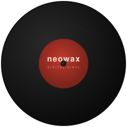

<p align="center">
  
</p>

<h1 align="center">neowax</h1>

<p align="center">
  A vinyl timecode DJ player written in Rust.<br>
  Heavily inspired by <a href="https://xwax.org/">xwax</a>, neowax is a clean-room rewrite that aims to bring digital vinyl playback to any Linux box with ALSA audio and enough horsepower to keep up.
</p>

## Philosophy

neowax is built for DJs who spin vinyl and don't want to touch CDJs or controllers. The goal is an appliance-like experience: power it on, it works. Pull the plug, everything is fine. No updates, no configuration wizards, no network dependency.

Features are intentionally kept to a minimum. We want the experience to be as close to actual vinyl as possible. That means:

- No BPM display
- No loops or cue points
- No playlists or library management
- No sync buttons

Just two views: a **player** with a waveform showing playback position, and a **library** to pick the next track. That's it.

## How it works

neowax reads timecode signal from a vinyl record through an ALSA input device, decodes the signal to determine playback position and speed, and plays back a digital audio file through an ALSA output device in sync with the vinyl. Currently supports Serato 2A timecode.

## Supported audio formats

MP3, FLAC, WAV, OGG/Vorbis, AAC/M4A, AIFF, PCM

## Requirements

- Linux with ALSA
- An audio interface with line/phono input and output
- A turntable with Serato Control Vinyl (Serato 2A timecode)
- Rust toolchain to build from source

## Building

```sh
cargo build --release
```

## Usage

```sh
neowax-ui --alsa <device> --library <path-to-music>
```

Both can also be chosen in the on-device Settings panel, so on a configured device plain `neowax-ui` is enough.

```sh
neowax-ui
```

### Options

| Option | Default | Description |
|---|---|---|
| `--alsa <device>` | | ALSA device for both input and output (e.g. `plughw:sndrpihifiberry`) |
| `--input-device <device>` | | ALSA input device (overrides `--alsa`) |
| `--output-device <device>` | | ALSA output device (overrides `--alsa`) |
| `-s, --sample-rate <hz>` | 48000 | Sample rate |
| `-t, --timecode <format>` | serato_2a | Timecode format |
| `--library, --crate <path>` | | Directory to scan for audio files (can also be chosen in Settings) |
| `--geometry <WxH>` | | Window size (e.g. `800x480`) |
| `--no-decor` | | Disable window decorations |
| `--speed <multiplier>` | 1.0 | Vinyl speed multiplier |
| `--phono` | | Enable phono-level input |
| `--swap-input` | | Swap left/right of the timecode input (if the record runs backwards) |
| `--buffer <frames>` | 256 | ALSA playback buffer size (~5.3ms at 48kHz) |
| `--capture-buffer <frames>` | 1024 | ALSA capture buffer size (~21ms at 48kHz) |
| `--capture-cpu <core>` | 3 | CPU core for the capture thread |
| `--playback-cpu <core>` | 2 | CPU core for the playback thread |

## Running as an appliance (Raspberry Pi)

The `.deb` sets the Pi up as a kiosk: installing it enables `neowax.service`, which takes over tty1 and runs neowax fullscreen in [cage](https://github.com/cage-kiosk/cage) as a dedicated `neowax` user. No login, shell profile or autologin needed.

```sh
sudo dpkg -i neowax_<version>_arm64.deb   # installs cage etc. via apt if needed: sudo apt install ./neowax_*.deb
```

What the package provides:

- **`neowax.service`**: starts on boot, restarts on crash. Logs: `journalctl -u neowax`. Stop it with `sudo systemctl stop neowax` (tty1 then returns to a login prompt once you also run `sudo systemctl start getty@tty1`).
- **USB automount**: a udev rule mounts USB drives with a filesystem under `/media/<device>` (read as the music library by default). Drives are mounted `nosuid,nodev,noexec`.
- **Settings**: stored in `/var/lib/neowax/.config/neowax/settings.toml`; choose the sound card and library in the on-device Settings panel. Extra command-line flags can go in `/etc/default/neowax` (`NEOWAX_ARGS`), but anything set there is locked in the panel.
- **Updates**: put a newer `neowax_*.deb` on a USB drive. The Settings panel shows "Install update"; it installs through a small root helper (`/usr/lib/neowax/install-update`, allowed via `/etc/sudoers.d/neowax`) that only accepts `neowax` packages. Anyone who can plug a drive into the device can therefore run code as root, so treat the box as physically trusted.

## Settings

Everything below can be changed in the on-device Settings panel (one encoder: scroll to move, click to select, click again to confirm a value; the touch screen works too). Changes are saved right away to `~/.config/neowax/settings.toml` (or `$XDG_CONFIG_HOME/neowax/settings.toml`). Settings marked `*` take effect after "Apply changes & restart".

The file is plain TOML and can be edited by hand:

```toml
accent = "Cyan"
swap_input = false
input_device = "plughw:sndrpihifiberry"
output_device = "plughw:sndrpihifiberry"
library = "/media/pi/MUSIC"
timecode = "serato_2a"
sample_rate = 48000
speed = 1.0
phono = false
buffer = 256
capture_buffer = 1024
capture_cpu = 3
playback_cpu = 2
```

A command-line flag always wins over the file. A setting forced by a flag is shown greyed out in the panel, marked "(command line)", and can't be changed there; remove the flag from your launch command to manage it from the panel.

## License

This project is licensed under the [GNU General Public License v3.0](LICENSE). You are free to use, modify, and distribute this software, provided that any derivative work is also released under the same license.
